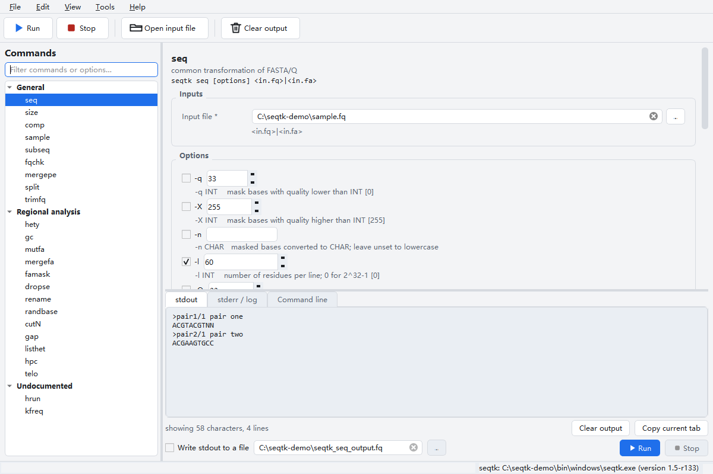
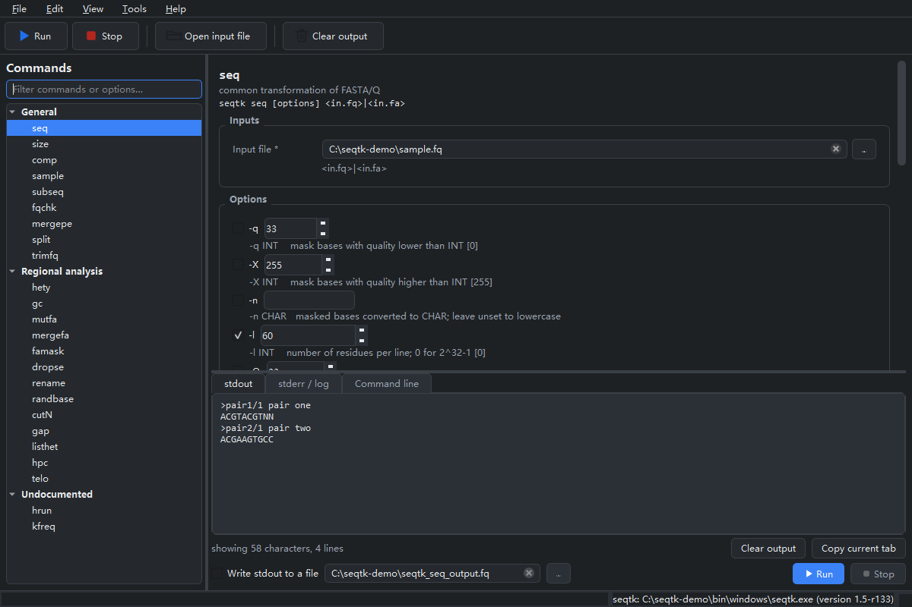

# SeqTK-GUI

<p align="center"></p>

**An unofficial graphical front end for [seqtk](https://github.com/lh3/seqtk).**
It is not affiliated with, endorsed by, or supported by seqtk or its author.
The GUI only builds command lines and runs the real `seqtk` executable - every
byte of sequence processing is done by upstream seqtk itself.

中文说明见 [README.zh-CN.md](README.zh-CN.md)。




## What it does

* Lists **all 24 subcommands** that seqtk 1.5-r133 actually dispatches - the 22
  documented ones plus `hrun` and `kfreq`, which are reachable from `main()` but
  missing from `seqtk`'s own usage text.
* Builds a parameter form per subcommand from a spec transcribed option-by-option
  from `seqtk.c`: flags, typed values, upstream defaults and value ranges.
* Runs seqtk without blocking the UI and shows **stdout**, **stderr** and the
  exact **command line** in three separate tabs.
* Optionally streams stdout straight to a file - the GUI equivalent of `>`, so
  multi-gigabyte FASTA never enters memory.
* Chinese / English UI, switchable at runtime. Light / dark theme, switchable at
  runtime.
* Remembers language, theme, working directory, recent files and the parameter
  state of every subcommand between launches.

Nothing is reimplemented in Python: if seqtk cannot do it, neither can this GUI.

## Requirements

| | |
| --- | --- |
| OS | Windows 10 / 11 (x64) today; the code paths are platform-split for macOS |
| Packaged exe | nothing - `dist/SeqTK-GUI.exe` is self-contained |
| Running from source | Python 3.10 or newer (3.11+ recommended) and PySide6 6.5 - 6.x |
| seqtk | bundled in the repository at `bin/windows/seqtk.exe`, or your own build |

The repository ships `bin/windows/seqtk.exe` (seqtk 1.5-r133, built from the
upstream source). See [docs/BUILD_SEQTK.md](docs/BUILD_SEQTK.md) for the exact
build command, for the small MinGW compatibility shim it needs, and for the
macOS/Linux equivalents.

## Run it

```powershell
python -m pip install -r requirements.txt
python main.py
```

On first start the app looks for seqtk in this order:

1. the path saved in settings (set it via **Tools > Locate seqtk executable…**);
2. `bin/windows/seqtk.exe` in the source tree - or the copy PyInstaller unpacks
   from inside the single-file build;
3. `seqtk` on `PATH`.

The status bar always shows which executable is in use and the version it
reported. If that version is not 1.5-r133, the status bar says so, because the
option list was derived from that release.

## Build a single-file executable

```powershell
tools\build_exe_windows.bat
```

That installs PyInstaller if needed and produces **`dist/SeqTK-GUI.exe` - one
file, no Python required**. The native `seqtk.exe` and both translation catalogs
are packed inside it and unpacked to a temporary directory on startup, so a user
who downloads that one file gets the complete application. First launch takes a
few seconds while it unpacks, and some antivirus tools flag freshly built
PyInstaller executables - sign the binary or hand out the folder build
(`ONEFILE=0 tools\build_exe_windows.bat`) if that matters for your users.

See [docs/DEVELOPMENT.md](docs/DEVELOPMENT.md) for the spec and for macOS packaging.

## Typical session

1. Pick a subcommand on the left (the filter box matches command names and the
   upstream help text).
2. Fill in the inputs; drag a FASTA/FASTQ file onto the window to drop it into
   the first file field.
3. Tick the options you need. Unticked options are **not** passed to seqtk, so
   upstream defaults stay in charge.
4. Check the command line tab, then press **Run** (Ctrl+R).
5. Read stdout in the result tab, warnings and errors in the log tab. For large
   outputs tick **Write stdout to a file** first.

## Documentation

| English | 中文 |
| --- | --- |
| [docs/USER_GUIDE.md](docs/USER_GUIDE.md) | [docs/USER_GUIDE.zh-CN.md](docs/USER_GUIDE.zh-CN.md) |
| [docs/COMMANDS.md](docs/COMMANDS.md) | [docs/COMMANDS.zh-CN.md](docs/COMMANDS.zh-CN.md) |
| [docs/BUILD_SEQTK.md](docs/BUILD_SEQTK.md) | [docs/BUILD_SEQTK.zh-CN.md](docs/BUILD_SEQTK.zh-CN.md) |
| [docs/DEVELOPMENT.md](docs/DEVELOPMENT.md) | [docs/DEVELOPMENT.zh-CN.md](docs/DEVELOPMENT.zh-CN.md) |
| [docs/THIRD_PARTY_NOTICES.md](docs/THIRD_PARTY_NOTICES.md) | [docs/THIRD_PARTY_NOTICES.zh-CN.md](docs/THIRD_PARTY_NOTICES.zh-CN.md) |
| [docs/RELEASE_CHECKLIST.md](docs/RELEASE_CHECKLIST.md) | [docs/RELEASE_CHECKLIST.zh-CN.md](docs/RELEASE_CHECKLIST.zh-CN.md) |
| [CONTRIBUTING.md](CONTRIBUTING.md) | [CONTRIBUTING.zh-CN.md](CONTRIBUTING.zh-CN.md) |

`docs/COMMANDS.md` is generated from the same spec the GUI renders:

```bash
python scripts/generate_commands_doc.py
```

## Tests

```bash
python -m pytest tests -q
```

The suite checks the spec against the getopt strings, the `main()` dispatch
chain and the version line parsed out of `seqtk.c` at run time, so nothing is
compared against hand-copied constants. It also translates every UI key in both
languages, drives the widgets offscreen, and - when a seqtk binary is present -
executes **every subcommand and every option** against it. The upstream source
is looked for at `../seqtk-1.5/seqtk.c`, or wherever `SEQTK_SOURCE` points; that
comparison is skipped, and says so, when the file is absent.

## Repository layout

```
main.py                     entry point
seqtk_gui/
  core/spec.py              the whole seqtk 1.5-r133 CLI surface, as data
  core/cli_build.py         spec + form values -> argv
  core/runner.py            QProcess streaming, stdout optionally to a file
  core/binary_locator.py    where seqtk lives, and which version it reports
  core/paths.py             per-platform layout (Windows today, macOS ready)
  core/settings.py          persisted preferences
  i18n/                     Chinese and English catalogs, runtime switching
  ui/                       main window, dynamic form, output tabs, themes
bin/windows/seqtk.exe       seqtk built from upstream source by this project
bin/windows/LICENSE.seqtk.txt  upstream notice, kept with that binary
tools/seqtk-build/          how that binary is produced
tests/                      unit + real-binary integration tests
docs/                       bilingual documentation, generated command table
```

## Porting to macOS

The GUI has no Windows-only code: `core/paths.py` maps `sys.platform` to a
`bin/<platform>/` directory and `core/binary_locator.py` looks for `seqtk`
instead of `seqtk.exe` there. Adding macOS means dropping a `bin/macos/seqtk`
build in place and adding a `.app` spec - see
[docs/DEVELOPMENT.md](docs/DEVELOPMENT.md#porting-to-another-os).

## License

MIT, see [LICENSE.txt](LICENSE.txt), which also reproduces the upstream seqtk
MIT notice verbatim, together with the MIT notices of `kseq.h` and `khash.h` -
the two headers `seqtk.c` includes, and which are therefore compiled into the
bundled `seqtk.exe` just like seqtk's own code is. seqtk itself stays under its
own MIT license: the option text transcribed into `seqtk_gui/core/spec.py` is
derived from seqtk, and the `bin/windows/seqtk.exe` this repository ships is a
copy of seqtk, so its notice is also kept in `bin/windows/LICENSE.seqtk.txt` and
packed into the built application. See
[docs/THIRD_PARTY_NOTICES.md](docs/THIRD_PARTY_NOTICES.md) for Qt/PySide6
(LGPL-3.0), zlib, OpenSSL and the rest.

## Disclaimer

Unofficial project. This software is not part of seqtk, is not a release of
seqtk, and is not approved or supported by seqtk's author; the name "seqtk"
belongs to that author's project and is used here only to describe what this
front end drives. This software is provided "as is", without warranty of any
kind. Always keep the raw input files: seqtk writes to stdout or to the output
path you choose and will overwrite an existing file without asking.
