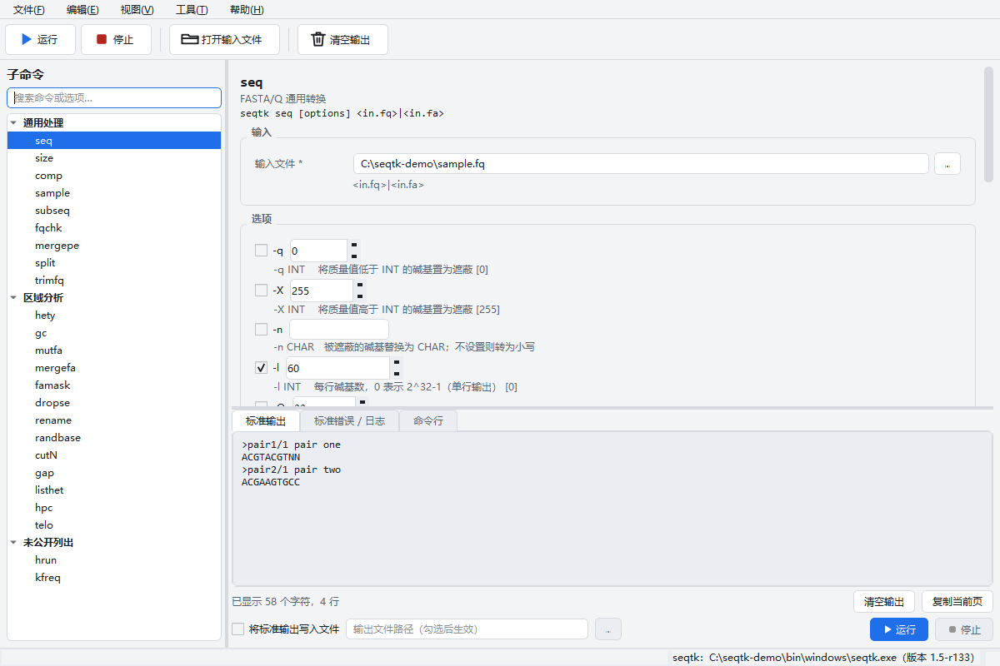
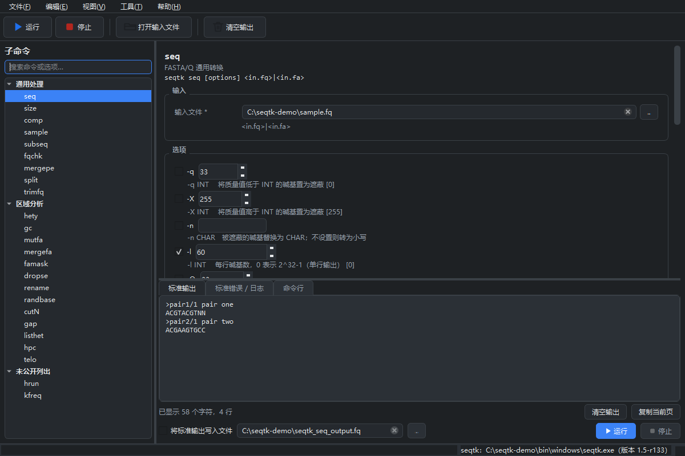

# SeqTK-GUI

<p align="center"></p>

**[seqtk](https://github.com/lh3/seqtk) 的非官方图形界面。**
本项目与 seqtk 及其作者没有任何关系，不受其认可，也不得其支持。
界面只负责拼命令行并调用真正的 `seqtk` 可执行文件——所有序列处理都由上游
seqtk 自己完成。

English documentation: [README.md](README.md)。




## 功能

* 列出 seqtk 1.5-r133 实际可分发的 **全部 24 个子命令**：帮助文本里的 22 个，
  外加 `main()` 能调用但帮助中没写的 `hrun` 与 `kfreq`。
* 每个子命令的参数表单都由 `seqtk.c` 逐条转录的规格驱动：开关、取值类型、
  上游默认值与取值范围。
* 调用 seqtk 时不阻塞界面，并在三个标签页中分别显示 **标准输出**、**标准错误**
  和实际执行的 **命令行**。
* 可把标准输出直接写入文件（等价于命令行的 `>`），几 GB 的 FASTA 也不会进入内存。
* 中英文界面，运行中即可切换；明亮/黑暗主题，运行中即可切换。
* 语言、主题、工作目录、最近文件以及每个子命令已填的参数都会记住。

Python 侧不重新实现任何算法：seqtk 做不到的事，这个界面也做不到。

## 运行环境

| | |
| --- | --- |
| 操作系统 | 目前为 Windows 10 / 11（x64）；代码按平台分层，便于迁移 macOS |
| 打包后的 exe | 无依赖，`dist/SeqTK-GUI.exe` 自包含 |
| 源码运行 | Python 3.10 及以上（推荐 3.11+）与 PySide6 6.5 - 6.x |
| seqtk | 仓库已提供 `bin/windows/seqtk.exe`，也可指向你自己编译的程序 |

仓库内含 `bin/windows/seqtk.exe`（seqtk 1.5-r133，由上游源码编译）。
编译命令、它所需的 MinGW 兼容补丁，以及 macOS/Linux 的对应做法见
[docs/BUILD_SEQTK.zh-CN.md](docs/BUILD_SEQTK.zh-CN.md)。

## 启动

```powershell
python -m pip install -r requirements.txt
python main.py
```

首次启动按以下顺序寻找 seqtk：

1. 设置中记录的路径（可通过 **工具 > 指定 seqtk 程序…** 修改）；
2. 源码运行时的 `bin/windows/seqtk.exe`；打包版则由 PyInstaller 从 exe 内部解压后再找到它；
3. `PATH` 中的 `seqtk`。

状态栏始终显示当前使用的是哪个程序及其自报版本。若版本不是 1.5-r133，状态栏会
明确提示，因为选项列表是依据该版本源码编写的。

## 打包成单个可执行文件

```powershell
tools\build_exe_windows.bat
```

脚本会在缺少 PyInstaller 时自动安装，产物是 **`dist/SeqTK-GUI.exe`——一个文件，用户无需
安装 Python**。原生的 `seqtk.exe` 与两份语言文案都打进这个文件，启动时解压到临时目录，
因此只下载这一个 exe 就能使用全部功能。首次启动需要几秒解压；部分杀毒软件会误报新编译的
PyInstaller 程序，若在意可以为二进制签名，或改用目录版打包
（`ONEFILE=0 tools\build_exe_windows.bat`）。

打包细节与 macOS 做法见 [docs/DEVELOPMENT.zh-CN.md](docs/DEVELOPMENT.zh-CN.md)。

## 典型流程

1. 在左侧选择子命令（搜索框同时匹配命令名与上游帮助文字）。
2. 填写输入；也可以把 FASTA/FASTQ 文件直接拖到窗口上，自动填入第一个文件框。
3. 勾选需要的选项。未勾选的选项**不会**传给 seqtk，因此由上游默认值决定行为。
4. 在“命令行”标签页确认无误后点击 **运行**（Ctrl+R）。
5. 结果在“标准输出”页，告警与报错在“标准错误 / 日志”页。输出很大时请先勾选
   “将标准输出写入文件”。

## 文档

| 中文 | English |
| --- | --- |
| [docs/USER_GUIDE.zh-CN.md](docs/USER_GUIDE.zh-CN.md) | [docs/USER_GUIDE.md](docs/USER_GUIDE.md) |
| [docs/COMMANDS.zh-CN.md](docs/COMMANDS.zh-CN.md) | [docs/COMMANDS.md](docs/COMMANDS.md) |
| [docs/BUILD_SEQTK.zh-CN.md](docs/BUILD_SEQTK.zh-CN.md) | [docs/BUILD_SEQTK.md](docs/BUILD_SEQTK.md) |
| [docs/DEVELOPMENT.zh-CN.md](docs/DEVELOPMENT.zh-CN.md) | [docs/DEVELOPMENT.md](docs/DEVELOPMENT.md) |
| [docs/THIRD_PARTY_NOTICES.zh-CN.md](docs/THIRD_PARTY_NOTICES.zh-CN.md) | [docs/THIRD_PARTY_NOTICES.md](docs/THIRD_PARTY_NOTICES.md) |
| [docs/RELEASE_CHECKLIST.zh-CN.md](docs/RELEASE_CHECKLIST.zh-CN.md) | [docs/RELEASE_CHECKLIST.md](docs/RELEASE_CHECKLIST.md) |
| [CONTRIBUTING.zh-CN.md](CONTRIBUTING.zh-CN.md) | [CONTRIBUTING.md](CONTRIBUTING.md) |

`docs/COMMANDS.zh-CN.md` 与界面使用同一份规格生成：

```bash
python scripts/generate_commands_doc.py
```

## 测试

```bash
python -m pytest tests -q
```

测试会核对规格与 `seqtk.c` 的 getopt 字符串是否一致、两种语言的界面文案键是否
齐全、离屏驱动界面控件，并在存在 seqtk 程序时**逐条执行每个子命令和每个选项**。

## 目录结构

```
main.py                     入口
seqtk_gui/
  core/spec.py              seqtk 1.5-r133 的完整命令面（纯数据）
  core/cli_build.py         规格 + 表单值 -> argv
  core/runner.py            QProcess 流式执行，标准输出可选直接落盘
  core/binary_locator.py    定位 seqtk 并识别其版本
  core/paths.py             分平台路径（当前 Windows，已为 macOS 预留）
  core/settings.py          偏好设置持久化
  i18n/                     中英文案与运行时切换
  ui/                       主窗口、动态表单、输出标签页、主题
bin/windows/seqtk.exe       本项目依上游源码编译出的 seqtk 程序
bin/windows/LICENSE.seqtk.txt  随该二进制一起保留的上游许可声明
tools/seqtk-build/          该程序的编译方式
tests/                      单元测试 + 真实程序集成测试
docs/                       双语文档、自动生成的命令表
```

## 迁移到 macOS

界面没有 Windows 专有代码：`core/paths.py` 依据 `sys.platform` 映射到
`bin/<platform>/`，`core/binary_locator.py` 在该目录下找 `seqtk` 而非
`seqtk.exe`。增加 macOS 支持只需放入 `bin/macos/seqtk` 并补一个 `.app` 打包配置，
详见 [docs/DEVELOPMENT.zh-CN.md](docs/DEVELOPMENT.zh-CN.md)。

## 许可证

本项目采用 MIT 许可，见 [LICENSE.txt](LICENSE.txt)，该文件除逐字保留上游 seqtk 的
MIT 声明外，还收录了 `kseq.h` 与 `khash.h` 的 MIT 声明——这两个头文件被 `seqtk.c`
包含，因此与 seqtk 自身的代码一样被编译进随附的 `seqtk.exe`。seqtk 本身始终适用其
自身的 MIT 许可：`seqtk_gui/core/spec.py` 中的选项文本派生自 seqtk，仓库随附的
`bin/windows/seqtk.exe` 是 seqtk 的一份副本，因此其许可声明也原样保存在
`bin/windows/LICENSE.seqtk.txt`，并会被打包进最终程序。Qt/PySide6（LGPL-3.0）、
zlib、OpenSSL 等其他组件见
[docs/THIRD_PARTY_NOTICES.zh-CN.md](docs/THIRD_PARTY_NOTICES.zh-CN.md)。

## 免责声明

本项目为非官方作品，不是 seqtk 的一部分，不是 seqtk 的发布版本，也未获得 seqtk 作者的
认可或支持；“seqtk”这一名称属于作者的该项目，本文只用于说明本界面驱动的对象。
本软件按“现状”提供，不含任何担保。请始终保留原始输入文件：seqtk 只写入标准输出或你
指定的路径，且覆盖已有文件前不会二次确认。
